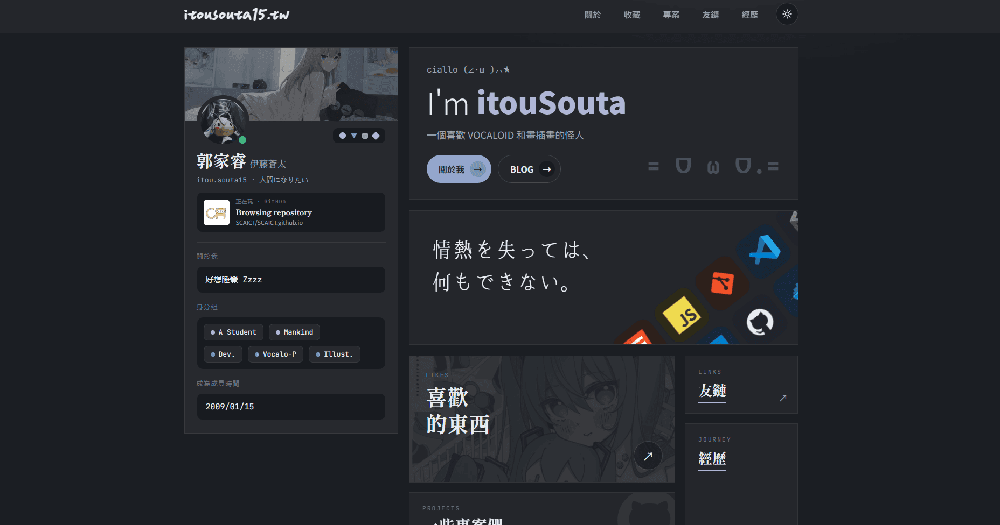

# itouSouta.me

English · [繁體中文](README.zh.md)



The source for [itousouta.me](https://itousouta.me), the personal website of itouSouta / 伊藤蒼太 / 郭家睿. It brings together projects, writing, favorite things, and small interactive details in one place.

## Explore the site

- `/` — Profile, Discord presence, visitor impressions, and a GitHub contribution calendar.
- `/about` — A little more about me.
- `/writing` — Markdown articles and a separate thoughts tab combining Threads, GitHub, and Discord-sourced posts.
- `/likes` and `/likes/music` — Favorite novels, manga, anime, VTubers, and searchable Spotify top tracks.
- `/projects` — Searchable projects with individual story and screenshot pages.
- `/links` and `/experience` — Friends, communities, and a timeline.
- `/api` — Public feeds, search index, status badges, and other endpoints.

The site also has a light/dark theme, Cmd/Ctrl+K search, a guestbook on supported pages, and an offline fallback. Articles have their own RSS feed at `/writing/feed.xml`; thoughts are available at `/feed.xml`.

## How it works

This is a **Next.js 14 App Router** project using **React, TypeScript, and plain CSS**. Most authored content lives in [`app/data/`](app/data/) and [`content/blog/`](content/blog/). Server routes and small client components add live data where needed:

- **Vercel KV** stores Discord-sourced thoughts, reactions, visitor impressions, and guestbook entries. Guestbook replies can trigger **Resend** email notifications; GitHub sign-in is optional.
- **Spotify** supplies top tracks and the currently playing song. The player can fall back to **Lanyard**, which also supplies Discord presence.
- **Threads and GitHub** supply activity for the thoughts feed and project cards. GitHub contributions are loaded separately when the calendar nears the viewport.
- The service worker in [`public/sw.js`](public/sw.js) provides a basic offline page and is registered only in production.

External services are optional for a local build; their dependent features show a fallback, an error state, or no data when credentials are unavailable.

## Run locally

Use **Node.js 20+** and npm:

```bash
npm ci
npm run dev
```

Open <http://localhost:3000>. No credentials are needed to start the site or build it. To enable live features locally, add the relevant variables to an untracked `.env.local`:

- `KV_REST_API_URL`, `KV_REST_API_TOKEN` — Vercel KV: thoughts, reactions, impressions, guestbook.
- `THREADS_ACCESS_TOKEN` — Threads posts in the thoughts feed.
- `GITHUB_TOKEN` — Authenticated GitHub API requests for projects and activity.
- `SPOTIFY_CLIENT_ID`, `SPOTIFY_CLIENT_SECRET`, `SPOTIFY_REFRESH_TOKEN` — Top tracks and now playing.
- `GITHUB_OAUTH_CLIENT_ID`, `GITHUB_OAUTH_CLIENT_SECRET`, `GUESTBOOK_GH_SECRET` — Optional guestbook GitHub sign-in.
- `RESEND_API_KEY`, `RESEND_FROM` — Guestbook reply notifications.
- `REVALIDATE_SECRET` — Authenticated `/api/revalidate` requests.

For a Spotify refresh token, configure the client ID and secret, register `http://127.0.0.1:8888/callback` in your Spotify app, then run `node --env-file=.env.local scripts/spotify-refresh-token.mjs`. The script requests `user-top-read` and `user-read-currently-playing`.

### Checks

```bash
npm run typecheck
npm run lint
npm run test:features
npm run test:blog
npm run format:check
npm run build
```

`npm run start` serves the production build. CI runs these checks with Node 20.

## Project map

- [`app/`](app/) — Pages, API routes, components, data, and shared helpers.
- [`content/blog/`](content/blog/) — Local Markdown articles and related content.
- [`public/assets/`](public/assets/) — Brand art, covers, and other site images.
- [`docs/`](docs/) — Implementation and authoring notes.

For more detail, see [architecture](docs/architecture.md), [blog authoring and migration](docs/blog-migration.md), [VTuber live status](docs/vtuber-live.md), and [easter eggs](docs/easter-eggs.md).

## License

Apache-2.0. See [LICENSE](LICENSE).
The bundled LINE Seed TW font is licensed under [SIL OFL 1.1](public/assets/fonts/LINE-Seed-TW-OFL.txt).
